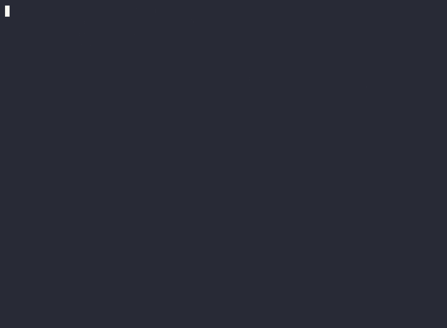

# fixlab


教學導向的最小 CLI coding agent：給它一個有 bug 的多檔 Python 小專案，它自己找出原因、修改原始碼、用 pytest 驗證。

模型自行決定下一步與何時完成；程式提供六個內建工具（`list_files`、`read_file`、`grep`、`edit_file`、`write_file`、`run_tests`；互動模式另可透過 MCP 接外部工具）、步數與連續失敗上限、檔案保護及 telemetry。這個專案也附有 20 篇教學文章與自建的多檔 bug benchmark，用來觀察修好率、假通過、既有功能退化與成本。

**主要發現：** 在這組 8 題 bug 上，9B 開源模型（Qwen3.5-9B）能自己跑測試時修好 82%，不能跑時只有 25%。沒有測試時它不是亂宣稱修好，而是一直搜尋、不敢結束；在 prompt 加一句停止規則後修好率回到約 81%，但多數執行仍停不下來。這是這組題目的觀察，不是一般成功率（見 [Benchmark 的觀察](#benchmark-的觀察)）。



上圖是在附帶的範例專案 `timelog` 上，用 Qwen3.5-9B 做的一次實際修復（8 步、約 1.3 萬 token）；單次錄影不代表成功率，統計見下方 benchmark。

**定位是修 bug。** 預設 system prompt 要求修復失敗行為，測試檔唯讀。`--task` 與互動輸入不會替換這個 system prompt；目前沒有拒絕非修 bug 請求的機制，其他任務也未經這套 benchmark 驗證。背景與範圍見 [AGENTS.md](AGENTS.md)。

## 安裝（一般使用者）

fixlab 只支援用 pytest 跑測試的 Python 專案；其他語言或測試工具的專案，`run_tests` 給不出有用的結果。

需要 Python 3.11 以上；電腦上沒有的話，先用 Homebrew（`brew install python`）或 python.org 的安裝程式裝一個（macOS 內建的 `/usr/bin/python3` 版本太舊）。用 uv 或 pipx 擇一安裝成指令，它們會自動建立獨立的虛擬環境，不必自己建 venv：

```
uv tool install git+https://github.com/albertkingdom/fixlab
pipx install git+https://github.com/albertkingdom/fixlab
```

裝好後若出現 `fixlab: command not found`，代表指令所在的 `~/.local/bin` 不在 PATH 上：執行 `uv tool update-shell` 或 `pipx ensurepath`，再開一個新的終端機。

沙箱只在 macOS 啟用；其他系統上測試在沒有沙箱的情況下執行，啟動時會印出 `sandbox: OFF`。

設定模型端點（寫進 `~/.zshrc` 之類的 shell 設定檔）。fixlab 本身不會讀 `.env` 檔：

```
export OPENAI_BASE_URL=https://openrouter.ai/api/v1   # 用 Ollama 就是 http://localhost:11434/v1
export OPENAI_API_KEY=...                              # Ollama 隨便填一個占位值
export FIXLAB_MODEL=qwen/qwen3.5-9b
```

之後在要修的專案目錄執行 `fixlab` 就會進入互動模式（在家目錄本身或更上層會被拒絕，要先 `cd` 到專案目錄）。`fixlab` 會直接修改目前目錄，請在已經 commit 或有備份的專案上用。

開發用安裝、範例專案與測試步驟見[開發指南](docs/development.md)。benchmark 題目沒有包進套件，需 clone 原始碼後執行，見[操作說明](docs/benchmark.md)。

## 快速使用

在已 commit 或有備份的專案操作，fixlab 會直接修改檔案：

```sh
cd /path/to/your-python-project
fixlab                         # 互動模式：輸入修復任務
```

也可指定目錄做一次性修復：

```sh
fixlab /path/to/your-python-project
```

互動模式會在改檔與跑測試前詢問；一次性模式直接執行，結束時印出差異並自行重跑測試，結束碼 0 表示最後測試通過、1 表示沒通過、2 表示輸入或設定有誤。

專案需要自己的 Python 環境時，在專案目錄執行 `fixlab --python .venv/bin/python`。該環境須有 Python 3.11 以上與 pytest；相對路徑從啟動目錄解析，不會自動偵測 `.venv`。完整選項、權限提示、事件檔與快照說明見[使用手冊](docs/usage.md)，展示流程見 [Demo 操作手冊](docs/cli-demo.md)。

### MCP（選用）

互動模式可呼叫外部 MCP 工具，**只支援由 fixlab 啟動的本機 stdio server**，不支援遠端 HTTP／SSE。每次呼叫都需要確認；server 以你的權限在沙箱外執行，只設定你信任的 server。

依原本安裝方式加入 MCP SDK 後，用 `fixlab --mcp-config /absolute/path/servers.json` 啟動。安裝指令、設定格式、可照做的本機 server 範例與錯誤排查見 [MCP 使用指南](docs/mcp.md)。

## 重要限制

- 針對小型、使用 pytest 的 Python 專案；模型須支援原生 tool calling，沒有任意 shell 工具。
- 測試固定使用 pytest 參數，忽略專案的 pytest 設定檔，不自動載入外掛；即使指定專案自己的 Python，結果仍可能與平常執行 pytest 不同。
- 測試沙箱僅在 macOS 且 `sandbox-exec` 可用時啟用；其他情況會顯示 `sandbox: OFF`，測試不受沙箱保護。`sandbox-exec` 已被標為棄用。
- 測試通過不代表 bug 一定修好；目前也無法完全防止被測程式偽造結果。互動模式結束任務後不會額外自動重跑測試。
- 對話只保留在同一個互動 session，沒有 context 長度管理；事件檔可能包含原始碼或祕密，分享前需檢查。

完整保護機制、適用範圍與已知缺口見[安全與限制](docs/safety.md)。

## Benchmark 的觀察

2026-10-18 的第一次完整實驗包含 8 題、2 個模型、兩個條件各 5 次，共 160 次，花費約 $0.41：Qwen3.5-9B 有 `run_tests` 時修好 33／40（82%），沒有時 10／40（25%）；Claude Haiku 5.5 兩個條件各 40／40。**這只是這組題目的觀察，不能當成一般成功率。**

[結果報告](docs/benchmark-results.md)包含設定、限制與後續 prompt 實驗；[benchmark 操作](docs/benchmark.md)說明自我檢查、評分與重跑方式。正式實驗需要 macOS 沙箱，加 `--confirm` 才會呼叫模型並產生費用。

## 進度與文件

| 階段 | 狀態 | tag |
|---|---|---|
| 1 骨架、六個工具與沙箱 | 完成 | `stage-1` |
| 2 互動 CLI 與 telemetry | 完成 | `stage-2` |
| 3 Benchmark 與實驗 | 完成 | `stage-3` |
| 4 選做 | MCP connector 完成；多 agent 對照未做 | |

| 想了解什麼 | 文件 |
|---|---|
| CLI、Python 環境、工具、事件檔與 diff | [使用手冊](docs/usage.md) |
| MCP 安裝、設定與連線範例 | [MCP 使用指南](docs/mcp.md) |
| 保護機制與已知限制 | [安全與限制](docs/safety.md) |
| 題目檢查、評分與模型實驗 | [Benchmark 操作](docs/benchmark.md)與[結果報告](docs/benchmark-results.md) |
| 開發安裝、程式閱讀順序、20 篇教學與設計文件 | [開發與教學指南](docs/development.md) |
| 階段 1 的逐步實跑與回饋修正 | [第一次完整的修復](docs/first-repair.md) |

可用 `git checkout stage-1`、`stage-2`、`stage-3` 或 `article-NN` 閱讀當時的程式。

## 未來規劃

- **重複呼叫偵測**：Qwen 沒有測試時會把步數全花在重複的 `grep`，目前只有「整輪全失敗」才算卡住；加上保險後可用現有 benchmark 重跑，看修好率與成本變化。
- **更難的題目與更多模型**：Haiku 5.5 在這組題目是 80／80，看不出差異。
- **多 agent 對照**：修復者加審查者對單一 agent，看審查者能否擋下假通過（階段 4 選做，尚未做）。

## 來源說明

前身是自己的 `code-agent-eval`。曾參考[高見龍的 KeSi 連載](https://kaochenlong.com/build-your-own-claude-code)與 [KeSi 專案](https://github.com/kaochenlong/KeSi)的工具保護、連續失敗計數、沙箱結構及成本量測等想法，也參考 Claude Code 的工具行為。KeSi 採 MIT 授權，Copyright (c) 2026 Eddie Kao；沙箱檔頭保留授權聲明。完整的閱讀紀錄、採用想法與差異見[參考來源](docs/development.md#參考來源)及 [Spectra 設計文件](docs/spectra/)。
