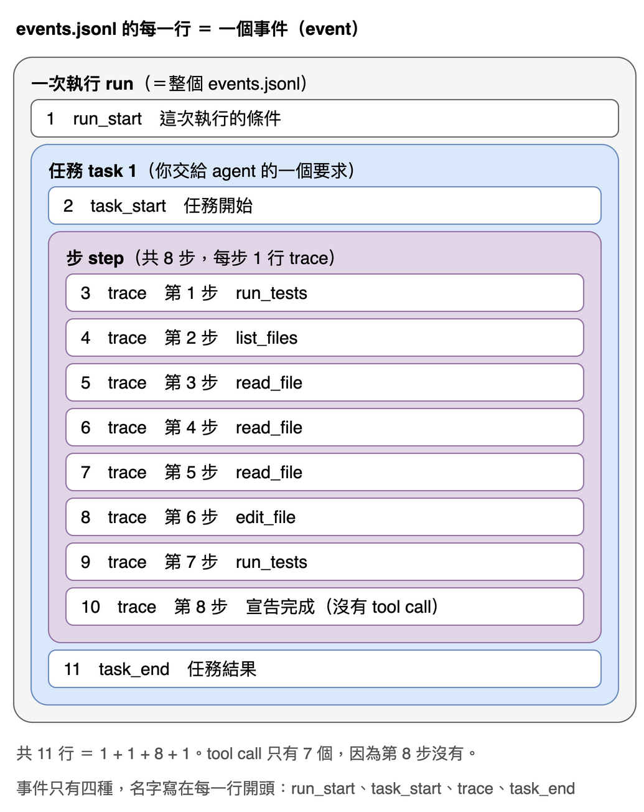
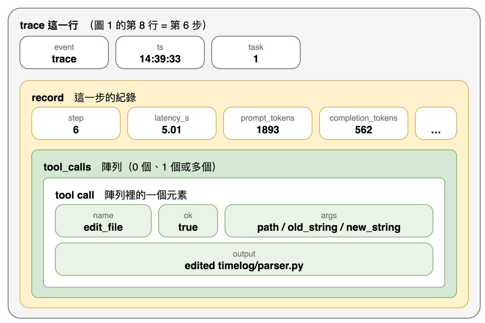
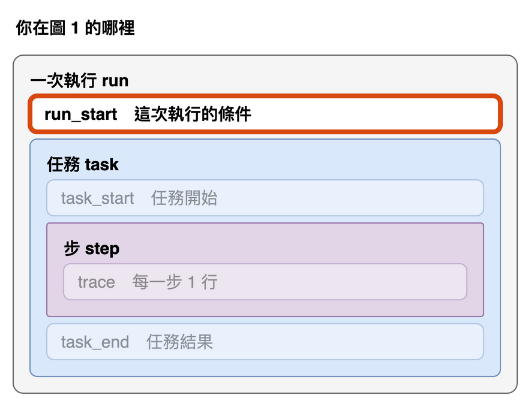
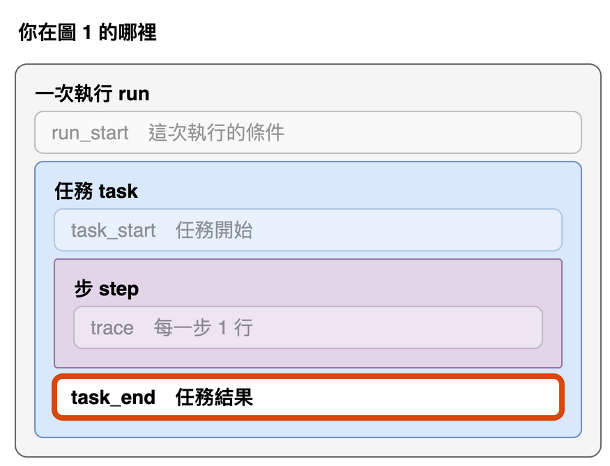
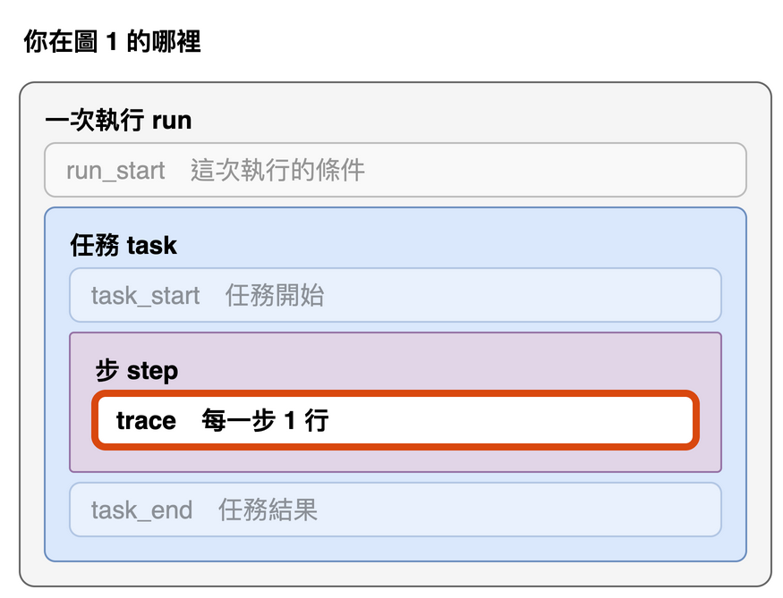

# 第 12 篇：把每次執行存下來（事件檔）

> 對應任務：stage2-cli-telemetry 的 2.1 到 2.4。
> 完成度：完成（寫這篇時，全部 302 個測試都通過，比階段 1 結束時的 260 個多 42 個，其中這一篇的事件檔模組 11 個、命令列入口 15 個）。目前只有一次性的 `fixlab PATH` 會寫事件檔，互動模式是下一篇的事。

到目前為止，`fixlab` 跑完一次只在畫面上留下幾行字。這一篇讓它把每次執行存成一個檔案，供之後統計使用。

## 要解決什麼問題

先看目前跑一次會留下什麼。下面是一次真實執行（模型 qwen3.5-9b，經 OpenRouter，修範例專案 timelog），畫面上每次工具呼叫各占一行：

```
run_tests  ok=True  flags={'tests_passed': False, 'timed_out': False}
list_files  ok=True  flags={}
read_file  ok=True  flags={}
read_file  ok=True  flags={}
read_file  ok=True  flags={}
edit_file  ok=True  flags={}
run_tests  ok=True  flags={'tests_passed': True, 'timed_out': False}
```

這幾行能看出「做了哪些事」，但回答不了下面這些問題：

- 每一步花了多少 token、多少秒？
- 這是哪個模型、哪個 provider、用哪一版的 fixlab 跑的？
- 每個 `read_file` 讀的是哪個檔案？模型改檔時寫了什麼？
- 一百次執行裡，有幾次修好、平均幾步？

最後一題是這個專案之後要回答的（階段 3 的 benchmark）。終端機一關，畫面上的字就沒了，而且是給人看的，不是給程式讀的。所以要存下來，而且存成程式讀得懂的格式。

這一篇要讓迴圈每一步產生的紀錄，除了印在畫面上，也寫進檔案。

## 先看全貌

事件檔是一個文字檔，**每一行是一個事件**（event）。下面是前面那次真實執行存下來的檔案，共 11 行：



事件只有四種，名字寫在每一行開頭：`run_start`、`task_start`、`trace`、`task_end`（後面「四種事件」一節再逐一說明）。

這些行可以分成三層，由大到小：

| 詞 | 意思 |
|---|---|
| 執行（run） | 從啟動 `fixlab` 到它結束。整個檔案就是一次執行，程式裡的 `run_start` 事件和 `~/.fixlab/runs/` 資料夾都用 run 這個字。互動模式裡，一次執行就是一個 session |
| 任務（task） | 你交給 agent 的一個要求，例如「修好 timelog 的 bug」。一次性模式只有 1 個，互動模式可以連續下很多個 |
| 步（step） | 問模型一次，再執行它要求的工具。**每一步寫成一行 `trace`**（名字來自第 11 篇的 trace 回呼：迴圈每交出一筆紀錄，就寫一行） |

把第 8 行（第 6 步）放大，一行 `trace` 裡面還有兩層：



| 詞 | 意思 |
|---|---|
| `record` | 這一步的紀錄（步數、延遲、token…）。它是 `trace` 這一行裡的**一個欄位** |
| tool call | 這一步執行的一個工具。它是 `record.tool_calls` 陣列裡的**一個元素**，不是獨立的一行 |

有兩件事要記住：

- 數工具呼叫次數，要展開每一行的 `tool_calls`，不能數行數。圖裡有 8 行 `trace`，但只有 7 個 tool call，因為第 8 步沒有。
- 請求遇到暫時性錯誤（429、5xx、連線）要重送時，那一步會多寫幾行 `trace`，內容是 retry，沒有 token 也沒有 tool call。細節在後面的「四種事件」。

## 先試最天真的做法，看它怎麼壞掉

最直覺的寫法：把每一步的紀錄放進一個 list，跑完再一次寫成檔案。

```python
records = []
...                      # 每一步 records.append(record)
json.dump(records, open("log.json", "w"))   # 最後才寫
```

這個做法有兩個問題，一個一眼就看得出來，另一個要做實驗才知道。

**程式中途掛掉，什麼都沒留下。** 這個程式會呼叫外部的模型、跑別人的測試，中途被打斷（Ctrl-C、被系統殺掉、當機）一點都不稀奇，而且最需要留下紀錄的，往往就是出事的那次。

**就算改成「每步寫一行」，也可能什麼都沒留下。** 這一點我是做了實驗才確定的。寫檔時，程式通常不會每次都真的寫到磁碟，而是先放在記憶體裡的**暫存區**，湊多一點才一起寫出去，就像寄信時先堆成一疊，再一起拿去郵局。程式被殺掉時，還在暫存區裡的就丟了。**flush** 就是「現在馬上送去郵局」。

實驗：兩個一模一樣的程式，各寫三行再模擬被殺掉（`os._exit`，不做任何收尾），差別只在有沒有 flush：

```
== plain: 檔案大小        0 位元組, 0 行
== flush: 檔案大小       36 位元組, 3 行
```

沒有 flush 的那個，三行全丟了。所以事件檔**每寫一行就立刻 flush**。代價是稍微慢一點，但模型一步要好幾秒，一行的寫入時間可以忽略。

## 格式：JSONL，一行一個 JSON

**JSONL**（JSON Lines）就是「一行一個完整的 JSON 物件」的文字檔。不用一個大的 JSON 陣列，原因就是前面提到的問題：陣列要等到最後的 `]` 才算合法，中途掛掉的檔案是壞的；JSONL 的每一行都是完整的，掛掉時最多只會少最後一行，前面的都讀得出來。它也方便用一般工具一行一行處理。

## 一次執行一個資料夾，永遠不覆寫

每次執行 `fixlab`，都會在 `~/.fixlab/runs/` 底下建立專屬的資料夾，名字是「UTC 開始時間加模型名稱」，檔案叫 `events.jsonl`。

- **為什麼不全部附加到同一個檔案？** 之後如果平行跑好幾題，各行會交錯，分不清誰是誰。一次一個資料夾，彙整時列出資料夾就好，某次執行出了問題，也只要刪掉對應的資料夾。
- **模型名稱常含斜線**（`qwen/qwen3.5-9b`），不能直接當資料夾名稱，所以不是字母、數字、`.`、`_`、`-` 的字元一律換成 `-`。
- **同一秒、同一個模型跑兩次怎麼辦？** 不覆寫、不附加，名稱已被使用就加 `-2`、`-3`。實際輸出：

```
20261018T093005Z-qwen-qwen3.5-9b
20261018T093005Z-qwen-qwen3.5-9b-2
20261018T093005Z-qwen-qwen3.5-9b-3
```

## 放在家目錄，不放進被修的目錄

預設位置是 `~/.fixlab/runs`，不是目前目錄底下的 `runs/`。原因有兩個，都是這個專案自己的情況：

1. **`fixlab` 會直接修改你指定的目錄，結束時會比較快照，印出「改了哪些檔」。** 事件檔如果寫在那個目錄裡，就會被當成「新增的檔案」印出來。
2. **模型與被測的程式都碰得到那個目錄。** 紀錄放在它們碰得到的地方，紀錄就不可信了（沙箱本來就禁止測試程式讀家目錄）。

所以用 `--log-dir` 指到被修的目錄裡面也會被拒絕，包括「被修的目錄就是家目錄」、以及用符號連結繞進去（比對前先解析成真實路徑）。實際輸出：

```
fixlab: error: the log directory /tmp/fixlab-demo/timelog/logs is inside the target /private/tmp/fixlab-demo/timelog; use --log-dir to put it elsewhere
exit code: 2
```

注意它印的「target」是 `/private/tmp/...`：macOS 的 `/tmp` 是符號連結，這就是「先解析成真實路徑」的結果。被拒絕時，不會建立任何檔案。

## 四種事件

前面說過，每一行是一個事件。每個事件都有 `event`（種類）和 `ts`（UTC 時間，毫秒，結尾 Z），種類只有四種：

| 事件 | 屬於哪一層（圖 1） | 什麼時候寫 | 內容 |
|---|---|---|---|
| `run_start` | 一次執行 | 開始，一次 | 這次執行的條件 |
| `task_start` | 任務 | 每個任務開始 | 任務序號與文字 |
| `trace` | 步 | 迴圈每產生一筆 record（通常每步一行） | 紀錄原樣放在 `record` 欄位 |
| `task_end` | 任務 | 每個任務結束 | 結果 |

為什麼有「任務」這一層？因為互動模式（下一篇）開著不關，可以連續下很多個要求，全部寫在同一個事件檔：

```
你> 修好 timelog 的 bug          ← 任務 1（一些 trace，最後 task_end）
你> 幫那個函式加 docstring       ← 任務 2（一些 trace，最後 task_end）
```

任務是一個接一個跑的，所以不會混在一起：任務 1 的 `trace` 全部寫完、寫了 `task_end`，才會出現任務 2 的 `task_start`。`task_start` 和 `task_end` 就是分界線。`trace` 另外帶 `task` 欄位，是讓每一行單獨拿出來也知道自己屬於哪個任務，例如用 `grep` 只篩出任務 2 的所有 `trace`。一次性模式只有一個任務（`task` 永遠是 1），但照樣寫這些事件，兩種模式的格式就一樣，統計腳本不用分開處理。

為什麼把 `trace` 的紀錄原樣放進 `record`，而不是攤平到外層？因為紀錄自己已經有一個叫 `event` 的欄位（值是 `tool_calls`、`done` 之類），攤平會撞名；採用巢狀結構，就完全不用改迴圈的紀錄格式。

`record` 裡的 `event` 欄位有五種值，說的是「這一步怎麼收場」：

| `record.event` | 意思 | `tool_calls` |
|---|---|---|
| `tool_calls` | 模型要求執行工具，已執行 | 有內容 |
| `done` | 回覆沒有工具呼叫，模型宣告完成，任務結束 | 空陣列 |
| `invalid_tool_call` | 回覆壞掉、沒有可執行的呼叫；把錯誤回饋給模型，再給一次機會 | 空陣列 |
| `retry` | 請求遇到暫時性錯誤，等一下重送（同一步內） | 沒有這個欄位 |
| `request_error` | 請求失敗而放棄，任務結束（`stop_reason` 是 `error`） | 沒有這個欄位 |

下面是前面那次真實執行的 `run_start` 與 `task_end`（路徑與 commit 縮短）。為了好讀，每個欄位拆成一行；實際檔案裡，每個事件都寫在同一行。

`run_start`（圖 1 的第 1 行）：



```json
{
  "event": "run_start",
  "ts": "2026-10-17T14:39:20.332Z",
  "schema": 1,
  "mode": "once",
  "model": "qwen/qwen3.5-9b",
  "base_url": "https://openrouter.ai/api/v1",
  "path": "…/smoke/timelog",
  "max_steps": 20,
  "max_tokens": 8192,
  "sandbox": "on",
  "fixlab_commit": "a4e1eb8…",
  "python": "3.14.8",
  "openai": "3.31.0",
  "meta": {
    "runtime": "OpenRouter",
    "note": "task-2.4"
  }
}
```

`task_end`（圖 1 的第 11 行）：



```json
{
  "event": "task_end",
  "ts": "2026-10-17T14:39:37.902Z",
  "task": 1,
  "stop_reason": "done",
  "steps": 8,
  "counters": {
    "tests_passed": 1
  },
  "prompt_tokens": 12818,
  "completion_tokens": 1249,
  "seconds": 17.39,
  "final_tests": {
    "tests_passed": true,
    "timed_out": false
  },
  "changed_files": {
    "added": [],
    "modified": ["timelog/parser.py"],
    "deleted": []
  }
}
```

`schema` 是格式的版本號，現在是 1；以後改欄位就加一，統計腳本讀檔時先檢查它。`final_tests` 是 `fixlab` 結束後自己再跑一次測試的結果（不是模型說了算），`changed_files` 來自印出差異的同一份快照。

中間的 `trace` 行就是每一步的紀錄，這是第 6 步（改檔），圖 1 的第 8 行：



```json
{
  "event": "trace",
  "ts": "2026-10-17T14:39:33.631Z",
  "task": 1,
  "record": {
    "event": "tool_calls",
    "step": 6,
    "latency_s": 5.01,
    "provider": "Venice",
    "prompt_tokens": 1893,
    "completion_tokens": 562,
    "reasoning_chars": 1346,
    "reply_tool_calls": 1,
    "truncated": false,
    "parse_errors": [],
    "tool_calls": [
      {
        "name": "edit_file",
        "ok": true,
        "flags": {},
        "args": {
          "path": "timelog/parser.py",
          "old_string": "    units = [re.match(r\"(\\d+)([hm])\", text).groups()]",
          "new_string": "    units = re.findall(r\"(\\d+)([hm])\", text)"
        },
        "output": "edited timelog/parser.py"
      }
    ]
  }
}
```

最外層的 `event`、`ts`、`task` 是事件檔加的；`record` 裡面才是迴圈產生的紀錄，這筆紀錄自己的 `event` 欄位在這裡是 `tool_calls`。為了篇幅，範例省略了 `record` 裡的 `finish_reason` 與 `content`（模型回覆的文字）。

這一篇新增了三個欄位：`truncated`（這個回覆是不是被輸出長度上限截斷）、`reply_tool_calls`（這個回覆原本帶了幾個工具呼叫，包含不合法、被丟掉的），以及 `protected_write`：被擋下的寫入會多這個旗標（模型想改測試檔），迴圈把它計入計數器 `protected_write_calls`，`task_end` 的 `counters` 就帶得到。這樣之後才能算出「模型試過幾次改測試檔」。

## 寫不進去，不能害執行失敗

事件檔不在主流程上。磁碟滿了、沒有權限，都不該中斷正在修 bug 的執行。所以寫入出錯時，只在畫面上警告**一次**，之後的事件直接略過，不再提示，agent 照常跑完。實際輸出（讓它寫進一個「其實是檔案」的路徑）：

```
fixlab: warning: the event log is unavailable, cannot create it ([Errno 20] Not a directory: '/var/folders/…/a_file/20261017T144146Z-m'); the run continues without it
```

兩次 `write` 都照常執行，沒有拋出例外。代價是這次執行少了資料，所以警告要寫清楚。

## 無法自動取得的條件：用 `--meta` 補

AGENTS.md 要求每次實驗記錄量化方式、runtime 版本、context 長度。但 OpenAI 相容的 API 不會告訴我們這些。階段 1 的實際執行，量化方式只能寫「未知」，context 長度只能寫「清單上標的」。自動偵測各家 runtime 要寫一堆特例，又不可靠，所以改由使用者自行提供：

```
fixlab ./repo --meta quantization=Q4_K_M --meta context_length=32768
```

值原樣放進 `run_start` 的 `meta`（一律是字串，只在第一個等號處分割，所以值裡面還能有等號）。缺等號會以退出碼 2 結束，而且不會建立任何檔案。

## 真的跑一次，看資料夠不夠

這個設計對不對，要看實際產生的檔案能不能回答前面那些問題。用 OpenRouter 對 timelog 的副本跑了一次（這是觀察，不是成績）：

| | |
|---|---|
| 模型 / provider | qwen/qwen3.5-9b / Venice |
| 結果 | 8 步修好，最後 `5 passed` |
| token | prompt 12,818、completion 1,249（依清單價格約 $0.0015） |
| 事件檔 | 11 行、7,340 位元組、最長一行 1,155 字元 |

只用這個檔案（不看畫面），能算出：

| 步 | 做了什麼 | 延遲 (秒) | prompt | completion |
|---|---|---|---|---|
| 1 | run_tests（失敗） | 1.77 | 1,081 | 46 |
| 2 | list_files | 1.40 | 1,281 | 75 |
| 3 | read_file | 1.38 | 1,346 | 42 |
| 4 | read_file | 2.17 | 1,508 | 180 |
| 5 | read_file | 1.36 | 1,651 | 61 |
| 6 | edit_file | 5.01 | 1,893 | 562 |
| 7 | run_tests（通過） | 1.13 | 2,004 | 26 |
| 8 | 宣告完成 | 2.77 | 2,054 | 257 |

各工具的呼叫次數：讀檔 3、列檔案 1、改檔 1、跑測試 2。延遲加總 17.0 秒，`task_end` 記的總耗時是 17.39 秒（多出來的是跑工具的時間）。prompt 一路增加是因為每一步都把前面的對話整份重送。`task_end` 的 token 與畫面上印出的 `12818 prompt + 1249 completion` 一模一樣。

## 已知限制

- **目前只有一次性模式會寫事件檔。** 互動模式與權限提示是下兩篇。互動模式的 `task_end`，`final_tests` 與 `changed_files` 會是 `null`。
- **`fixlab_commit` 只記 git HEAD。** 看不出當時工作樹有沒有未提交的修改，髒的工作樹跑出的結果會被記在乾淨的 commit 名下。階段 3 的實驗要在乾淨的工作樹上跑；要自動分辨的話，之後可以在 `run_start` 加一個 `fixlab_dirty`。
- **事件檔裡有模型的回覆與工具的輸出**（每筆最多 2,000 字元），可能包含目標專案的原始碼或祕密。放在家目錄、不進版控，也不要隨意分享。
- **不記費用。** 單價會變，只記 token，由階段 3 的彙整腳本換算。
- **`trace` 的參數與輸出超過 2,000 字元會被截斷**（這是紀錄本身的規則，不是事件檔加的）。這些資料不足以完整還原一次執行，但足以用來統計。
- **只有一次真實執行的證據。** 上面的表格只說明「格式能回答這些問題」，不說明任何模型的表現。

## 參考來源

- **高見龍 KeSi**（`kesi.py`，MIT 授權，Copyright (c) 2026 Eddie Kao，commit `dfa0cd0`，2026-10-17 讀）：它沒有 JSONL 事件記錄。token 與費用記在記憶體裡的一個記帳物件，用 `/cost` 指令或每輪結束時印出來，程式結束就沒了。所以事件檔的格式、位置與寫入方式沒有可參考的做法，依據是這個專案自己的需求（階段 3 要統計修好率、假通過與成本）與上面那些實驗。

## 下一篇

互動模式：讓 `fixlab` 在同一個 session 裡連續下指令、保留對話。其中有個細節：對話被 Ctrl-C 打斷時，要怎麼避免留下不完整的對話。
