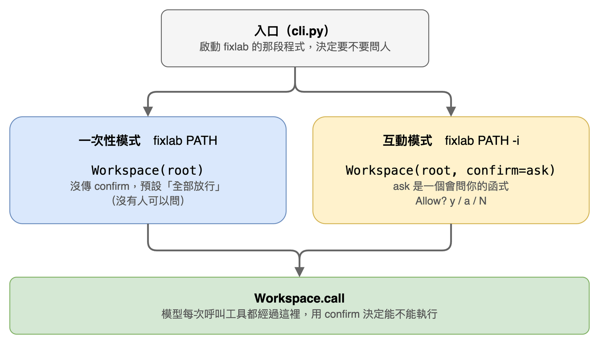
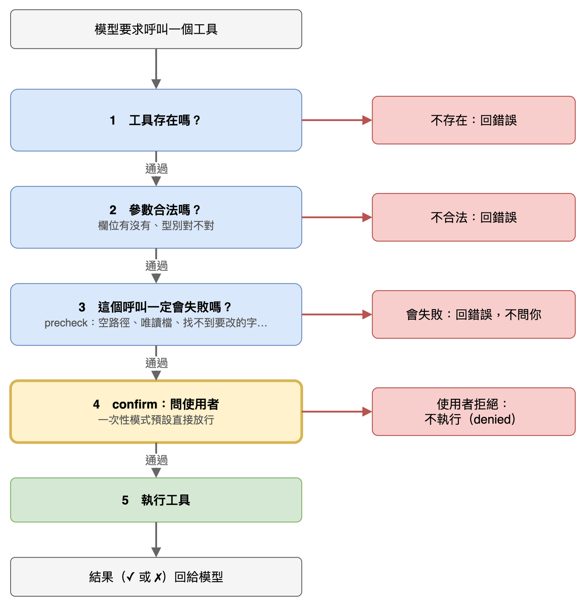

# 第 14 篇：改檔和跑測試之前先問你（權限提示）

> 對應任務：stage2-cli-telemetry 的 1.4 與 3.3。
> 完成度：完成（全部測試 398 個通過）。

互動模式（第 13 篇）有人在旁邊。這一篇讓 `fixlab` 在動手改東西之前，先問一聲。

## 為什麼現在要問

一次性的 `fixlab PATH` 沒有人在旁邊可以問，所以我們用**事後審查**：結束時印出快照差異，再自己跑一次測試（第 3 篇）。互動模式不一樣，使用者就在螢幕前，與其事後才發現模型改了不該改的，不如在它動手之前讓使用者決定。

## 先試最天真的做法，看它怎麼壞掉

最直覺的寫法：在每個會寫入的工具裡，直接問一句。

```python
def edit_file(ws, path, old_string, new_string):
    if input("Allow? [y/N]: ") != "y":
        return ToolResult("declined", False)
    ...
```

它有三個問題：

1. **沒有人在的時候會當掉。** 一次性模式沒有人可以回答，`input()` 在標準輸入已經關掉的情況下的實際反應是：

```
$ python3 -c "input('Allow? [y/N]: ')" < /dev/null
EOFError: EOF when reading a line
```

   整個工具呼叫以例外收場，違反「工具錯誤不能讓迴圈崩潰」。
2. **三個會寫入的工具要各抄一份**（改檔、寫檔、跑測試），漏一個就是漏洞。
3. **政策和工具混在一起。** 「要不要問」是使用者的偏好，不是改檔這個動作的一部分；一次性模式、互動模式、之後 benchmark 的批次執行，各自的答案都不一樣，卻共用同一份工具程式。

## 做法：入口決定要不要問，Workspace 照做

先看誰決定什麼：



- **入口**（`cli.py`，啟動 `fixlab` 的那段程式）決定要不要問人。
- 建立 `Workspace` 時多傳一個 `confirm`。它是一個函式，收到工具名稱和參數，回 True 就執行，回 False 就不執行。
- 一次性模式不傳 `confirm`，預設是「全部放行」，行為和以前完全一樣。互動模式傳一個會問你的函式。

這和「哪些檔案唯讀」是同一個結構（`read_only` 參數，第 4 篇）：由入口決定，工具和迴圈都不管。放在 `Workspace` 而不是迴圈，是因為這個專案對 agent 的定義是「由模型決定下一步，程式只設保險」；把「要不要問」寫進迴圈，迴圈就變成寫死的流程了。

模型每次呼叫工具，都會經過 `Workspace.call` 這道門，依序過五關：



- 前三關檢查的是「這個呼叫本來就會失敗」，失敗就直接回錯誤，**不拿去問你**：問了才失敗，等於讓你放行一個注定失敗的呼叫。
- 第 3 關是 `edit_file`、`write_file`、`run_tests` 各自的 `precheck`：只驗證、不做事（空路徑、唯讀檔、找不到要改的文字、新舊文字相同、沒讀過就覆寫…）。工具本身開頭也呼叫同一份驗證，所以每條規則只有一份程式。
- 只有走到第 4 關才會問人。

使用者拒絕的呼叫，結果是 `ok=false`，旗標 `denied`，輸出：

```
error: the user declined this call. Do not retry it unchanged; try a different approach or ask the user what they want.
```

這句話是寫給**模型**看的：告訴它不要原樣重送，換個做法或問使用者。

## 互動入口的提示函式

互動模式傳進去的 `confirm`，只對會改東西的三個工具問：`edit_file`、`write_file`、`run_tests`。讀取類（`read_file`、`list_files`、`grep`）直接放行。

問題長這樣（要動什麼已經在前面的標題行與差異裡，第 13 篇）：

```
    Allow? [y]es / [a]lways for this tool / [N]o:
```

| 輸入 | 結果 |
|---|---|
| `y`、`yes`（不分大小寫、去掉前後空白） | 這次放行 |
| `a`、`always` | 這次放行，而且**這個 session 內**同一個工具之後都不再問 |
| `n`、空行、`yes please`、其他任何東西 | 拒絕 |
| 輸入結束（Ctrl-D） | 拒絕 |
| Ctrl-C | 中斷整個任務（第 13 篇） |

預設是拒絕（大寫的 `N`）：只有明確打 `y`／`yes` 或 `a`／`always` 才會執行，打錯字不會放行。輸入結束時沒有人可以同意，也是拒絕。

為什麼 `run_tests` 也要問？它會執行程式，而被執行的程式包含模型剛剛改寫過的檔案。它跑在沙箱裡（第 9 篇），但使用者應該知道什麼時候它在跑。

### 真實的畫面

下面是目前的版本、用真模型（qwen3.5-9b，OpenRouter）跑的兩段互動，2026-10-18。目的只是讓你看到提示在實際使用時長什麼樣，不是成績。啟動時印的路徑略過。

**放行：** 先問一個只讀檔的問題，再要求加 docstring，改檔時回答 `y`：

```
fixlab> read timelog/parser.py and tell me in one sentence what its main function does

  ▸ read_file timelog/parser.py
    ✓

The `parse_duration` function in parser.py parses time duration strings (like "2h", "45m", "1h30m") and converts them to a total number of minutes.

(2 steps · 2,470 + 204 tokens · 6 s)
fixlab> add a docstring to that function

  ▸ read_file timelog/parser.py
    ✓
  ▸ edit_file timelog/parser.py
    @@ line 5
     5
     6
     7   def parse_duration(text):
     8 -     """回傳 text 代表的分鐘數，格式不對時拋 ValueError。"""
       +     """Converts a duration string (like '2h', '45m', '1h30m') to the total number of minutes. Raises ValueError for invalid formats."""
     9       text = text.strip()
    10       if not re.fullmatch(r"(\d+[hm])+", text):
    11           raise ValueError(f"invalid duration: {text!r}")
    Allow? [y]es / [a]lways for this tool / [N]o: y
    ✓
  ▸ read_file timelog/parser.py
    ✓
  ! the model's tool call was invalid: empty response (no text and no tool call)

Added an English docstring to the `parse_duration` function explaining its purpose.

(5 steps · 8,987 + 666 tokens · 18 s)
```

**拒絕：** 第一次問 `run_tests` 時回答 `n`：

```
fixlab> run the tests, then fix the failing test

  ▸ run_tests
    ✗ path must be a non-empty string
  ! the model's tool call was invalid: empty response (no text and no tool call)
  ▸ run_tests .
    Allow? [y]es / [a]lways for this tool / [N]o: n
    ✗ declined
  ▸ list_files .
    ✗ path must be a non-empty string

(stopped: stuck · 4 steps · 4,703 + 179 tokens · 12 s)
```

幾個地方可以對照看：

- 讀檔（`read_file`）沒有提示，直接 `✓`。
- 改檔先顯示差異（第 13 篇）再問，回答 `y` 之後才有 `✓`；拒絕的結果行是 `✗ declined`。
- 沒有提問就出現的 `✗ path must be a non-empty string`，是模型給了空的路徑：這種一定會失敗的呼叫不會問你（上面的第 3 關）。第二段最後以 `stuck` 結束，是連續幾輪的呼叫都失敗（包括被拒絕的那一次），保險機制停下了任務（第 11 篇）。

## 拒絕算失敗

被拒絕的呼叫會計入**連續失敗保險**（第 11 篇）：連續三輪、每個呼叫都失敗，任務就以 `stuck` 結束。

旗標用獨立的 `denied`，不和 `blocked` 混在一起：`blocked` 是**規則**擋下的（路徑逃逸、寫唯讀檔案），`denied` 是**人**決定的。事件檔要分得出來，之後統計才不會把「使用者不同意」算成「模型亂來」。實際輸出，使用者連續三次拒絕同一個改檔（第二、三次與第一次相同，這裡只留第一次）：

```
fixlab> fix it

  ▸ edit_file timelog/parser.py
    @@ line 9
     9       text = text.strip()
    10       if not re.fullmatch(r"(\d+[hm])+", text):
    11           raise ValueError(f"invalid duration: {text!r}")
    12 -     units = [re.match(r"(\d+)([hm])", text).groups()]
       +     units = re.findall(r"(\d+)([hm])", text)
    13       return sum(int(number) * (60 if unit == "h" else 1) for number, unit in units)
    Allow? [y]es / [a]lways for this tool / [N]o: n
    ✗ declined
  … 同樣的再兩次 …

(stopped: stuck · 3 steps · 30 + 15 tokens · 0 s)
```

要不要這樣算，我不確定。使用者連拒三次，可能就是不想讓它做這件事，這時停下來很合理；但這也會把使用者的選擇記成「卡住」。設計文件把它列為待觀察的問題，先照這樣做，用過之後再調整。

## 「一律放行」的範圍

`a` 放行的是**整個工具**：放行一次 `edit_file`，這個 session 之後所有的 `edit_file` 都不問（唯讀的測試檔仍然擋得住，那是另一道規則）。它在 `/reset` 之後仍然有效，離開就沒了。

這個範圍比較粗。高見龍的 KeSi 比較細：改檔與寫檔的授權記在**每個檔案路徑**，shell 指令記在**每個完整的指令字串**，所以放行「改 `a.py`」不會連帶放行「改 `b.py`」。他也有 `/permissions` 看目前授權了什麼、`/revoke` 全部收回。我們目前都沒有。

取捨是：粗的範圍問得少，但放行的範圍大。因為修 bug 時模型常常連續改好幾個檔，一個檔問一次會很煩；但如果以後要在更大的範圍用，細的做法比較安全。這是之後可以改的地方，不是已經證明這樣比較好。

## 一次性模式從不問

`fixlab PATH`（沒有 `-i`）不傳 `confirm`，所以不會問任何問題，也不會有任何呼叫被拒絕。有一個測試把 `input()` 換成「一被呼叫就失敗」，確認一次性模式整個跑完都沒碰它。

## 與 KeSi 的對照

我讀了他的 `check_permission` 與 `ask_user`。

| | 高見龍 KeSi | fixlab |
|---|---|---|
| 會問的工具 | 改檔、寫檔、shell 指令 | `edit_file`、`write_file`、`run_tests`（沒有任意 shell） |
| shell 指令 | 先過規則分類：直接放行、直接擋下、或問 | 不需要：沒有任意 shell |
| 「都好」的範圍 | 每個檔案、每個完整指令 | 整個工具 |
| 看與收回授權 | `/permissions`、`/revoke` | 沒有 |
| 回答 | `y`／`yes`、`a`／`all`，其他拒絕 | `y`／`yes`、`a`／`always`（不分大小寫），其他拒絕 |
| 沒有人可以問 | 標準輸入不是終端機就自動拒絕 | 輸入結束（EOF）才拒絕 |
| 被拒絕算失敗 | 算，連續 3 輪停 | 相同 |
| 問題裡顯示什麼 | 檔案路徑；指令顯示完整內容與理由 | 路徑加整個檔案的差異，帶上下文與行號（前面的標題行與差異） |

有一個差異值得注意：他在標準輸入**不是終端機**時就自動拒絕；我們只有在輸入**結束**時才拒絕。如果有人把輸入用管線餵進去（`echo ... | fixlab -i`），我們會把管線裡的下一行當成回答，他則一律拒絕。

## 已知限制

- **授權範圍比較粗**，而且沒有 `/permissions` 與 `/revoke` 可以看和收回。
- **連續被拒絕三輪算 `stuck`**，這個算法還沒有實際使用的經驗。
- **管線輸入會被當成回答**（他的做法是不在終端機就拒絕）。
- **只有互動模式會問**；一次性模式靠事後的差異與重跑測試。

## 參考來源

- **高見龍 KeSi**（`kesi.py`，MIT 授權，Copyright (c) 2026 Eddie Kao，commit `dfa0cd0`，2026-10-17 讀）：設計時只看過 commit 標題（「permission gate with session grants」），`y`／`a`／`N` 與「這個 session 都好」的想法與他相同，不能排除受他影響；完成之後才讀了 `check_permission` 與 `ask_user`，做了上面的對照。`confirm` 參數放在 Workspace、`denied` 旗標與 `blocked` 分開、先檢查（結構與 `precheck`）再問，是依這個專案自己的結構（由入口決定政策、迴圈只設保險）設計的。
- **Claude Code 的行為**：寫檔與執行指令前會問「這次允許、這個 session 一律允許、拒絕」三種，是 `y`／`a`／`N` 的來源，來自使用經驗。2026-10-18 查官方文件（code.claude.com/docs/en/permissions.md）：「Yes, and don't ask again」的效期是到 session 結束，和 `a` 一致；提示上各選項的文字，文件沒有寫。

## 下一篇

階段 2 的收尾：README 與 `stage-2` 的 tag。
