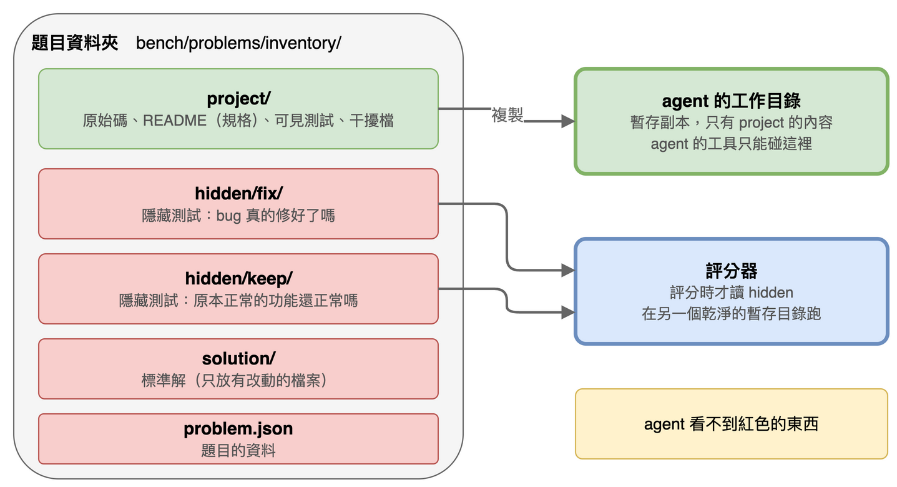
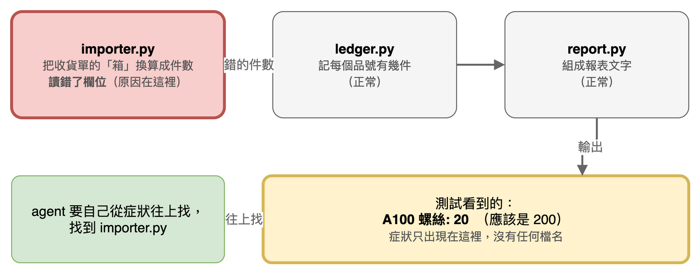

# 第 15 篇：題目長什麼樣（8 道有 bug 的小專案）

> 對應任務：stage3-benchmark 的 2.1、2.2 與第 5 組（8 個題目）。
> 完成度：完成。8 題都通過自我檢查（第 17 篇）。

前面 14 篇做出了一個會自己修 bug 的 agent。這一篇開始回答一個問題：**它修得好不好？** 要回答，得先有一組固定的題目。

## 先試最天真的做法，看它怎麼壞掉

最直覺的題目是這樣：一個有 bug 的小專案，加上幾個失敗的測試。agent 修到測試通過，就算成功。

這有兩個問題。

**問題一：agent 可以只讓看得到的測試過關。** 下面是我真的做的實驗：在庫存題目裡，我手寫了一個「作弊」的修法，只對螺絲這一個品項寫死答案。看得到的測試過了，bug 其實還在。

```
{"visible_passed": true, "fix_passed": false, "keep_passed": true, "invalid": false, "tampered_files": [], "outcome": "overfit"}
```

`visible_passed: true`（看得到的測試過了）、`fix_passed: false`（bug 沒修好）。如果只看看得到的測試，這會被算成成功。這就是「假通過」。

**問題二：失敗訊息如果直接說出原因，就不用找了。** 第一個範例專案 timelog 的測試訊息是 `3.75 != 4.25`，直接告訴你差了多少。agent 一看就知道問題在哪個計算，不需要探索。這樣量不出 agent 找 bug 的能力。

所以題目要做到兩件事：**有一組 agent 看不到的測試**用來檢查真正有沒有修好；**失敗訊息只讓人看到症狀，不指出原因的位置**。

## 一道題目長什麼樣

每道題是一個資料夾。下面是第一題「庫存」的所有檔案（真實輸出）：

```
$ find bench/problems/inventory -type f | sort
bench/problems/inventory/hidden/fix/test_cases.py
bench/problems/inventory/hidden/keep/test_basics.py
bench/problems/inventory/problem.json
bench/problems/inventory/project/README.md
bench/problems/inventory/project/stock/__init__.py
bench/problems/inventory/project/stock/catalog.py
bench/problems/inventory/project/stock/importer.py
bench/problems/inventory/project/stock/ledger.py
bench/problems/inventory/project/stock/legacy_import.py
bench/problems/inventory/project/stock/report.py
bench/problems/inventory/project/tests/test_stock_report.py
bench/problems/inventory/solution/stock/importer.py
```



- **`project/`** 是給 agent 的專案：程式、一份 README（寫明正確的行為）、看得到的測試。agent 拿到的是它的暫存副本，改壞了也不影響題目本身。
- **`hidden/fix/`** 和 **`hidden/keep/`** 是 agent 看不到的兩組測試（下一節說明）。
- **`solution/`** 是標準解，只放有改動的檔案。用來驗證題目本身做對了。
- **`problem.json`** 記題目的資料：領域、bug 的類型、bug 在哪個檔案、各組有幾個測試。

agent 只能碰它的工作目錄。隱藏測試和標準解在另一個地方，評分時才會被讀（第 16 篇）。

## 症狀在下游，原因在上游

這道題的 bug 在 `importer.py`：把收貨單的「箱」換算成件數時，讀錯了欄位。但你在測試裡看不到這個檔名，只看到報表的數字不對。下面是 agent 跑看得到的測試時，真的會看到的輸出：

```
.F                                                                       [100%]
=================================== FAILURES ===================================
___________________________ test_one_case_of_screws ____________________________

    def test_one_case_of_screws():
>       assert stock_report(["A100,2,case"]) == "A100 螺絲: 200\nTOTAL units 200"
E       AssertionError: assert 'A100 螺絲: 20\nTOTAL units 20' == 'A100 螺絲: 200...TAL units 200'
E         
E         - A100 螺絲: 200
E         ?            -
E         + A100 螺絲: 20
E         - TOTAL units 200
E         ?               -
E         + TOTAL units 20

tests/test_stock_report.py:9: AssertionError
=========================== short test summary info ============================
FAILED tests/test_stock_report.py::test_one_case_of_screws - AssertionError: ...
1 failed, 1 passed in 0.03s
```

報表說 20，應該是 200。但哪裡錯了？是目錄的資料、換算、記帳、還是報表？agent 得自己從報表往上追，讀 `report.py`、`ledger.py`，最後找到 `importer.py`。



而且專案裡還有一個「干擾檔」`legacy_import.py`：舊版的匯入程式，看起來很可疑，其實沒有人用它。它的作用是讓只靠檔名猜的 agent 猜錯。

## 隱藏的兩組測試

隱藏測試分兩組，各回答一個問題：

| 組 | 問題 | 庫存題的例子 |
|---|---|---|
| `fix` | bug 真的修好了嗎？ | 一箱墊圈是 24 件；一箱螺帽加兩包加三件，總共 63 件 |
| `keep` | 原本正常的功能還正常嗎？ | 兩包螺絲是 20 件；不認識的品號要略過；空的收貨單只有一行 `TOTAL units 0` |

只有 `fix` 沒有 `keep` 的話，agent 把整個函式改壞、只要答案湊對就能過關，量不出「弄壞原本正常的功能」。

兩組測試都只透過 README 列出的公開入口（`stock.report.stock_report`）測試，不直接呼叫內部函式。這是因為有些題目改哪個模組都說得通，只測公開入口，兩種合理的修法才不會被判成不同的結果。

## 八道題

每題一個不同的小領域，bug 的類型也不同：

| 題目 | 領域 | bug 的類型 | 症狀 |
|---|---|---|---|
| `inventory` | 庫存 | 匯入時「箱」換算讀錯欄位 | 報表總數不對 |
| `calendar` | 行事曆 | 兩個模組對「結束日含不含」的約定不一致 | 衝突檢查漏報 |
| `settings` | 設定載入 | 預設值被拿去修改，影響下一次載入 | 第二次載入帶到上一次的值 |
| `billing` | 金額 | 折扣碼不存在時，例外被吞掉 | 打錯折扣碼也沒有錯誤，總額偏高 |
| `subscription` | 訂閱到期 | 一個模組存 UTC，另一個用本地時間比較 | 訂閱提早 8 小時過期 |
| `paging` | 分頁 | 總頁數在兩個地方各算一次，算法不同 | 最後一頁的頁尾不對 |
| `scheduler` | 排程 | 最自然的修法會弄壞另一個模組 | 優先權低的任務排在前面 |
| `permissions` | 權限 | 例外的繼承關係讓 `except` 抓錯 | 被停權的人還能讀 |

`scheduler` 是一道「陷阱題」：只把排序的鍵加個負號是最直覺的修法，可見測試的失敗訊息裡還有一行「Buckets」會告訴你這樣不夠；沒有 `run_tests` 的 agent 看不到這個訊息，會直接弄壞 `keep` 組。我實際驗證過：這個直覺修法的結果是 `broke_existing`。這題是用來看「能自己跑測試」和「不能」的差別。

## 題目不能依賴環境

題目在每台機器上都要得到同樣的結果。所以：不看系統時區（訂閱題把「本地時間比 UTC 快 8 小時」寫成程式裡的常數）、不依賴現在的時間、不依賴亂數與集合的順序。`run_tests` 跑測試的行程也固定了時區（UTC）與雜湊順序，而且不自動載入 pytest 外掛（第 16 篇會再提到為什麼）。

## 自己跑一次

在專案資料夾（要先照 README 裝好環境）：

```
python -m fixlab.bench check inventory --repeat 3
```

預期輸出一行 `inventory: passed`。這個指令的意思是第 17 篇講的自我檢查。

## 名詞表

| 詞 | 意思 |
|---|---|
| 題目 | 一個資料夾：一個有 bug 的小專案，加上測試與標準解 |
| `project` | 給 agent 的專案，agent 拿到它的暫存副本 |
| 可見測試 | 在 `project` 裡、agent 看得到的測試，一開始有失敗的 |
| 隱藏測試 | agent 看不到的測試，分 `fix` 與 `keep` 兩組 |
| `fix` 組 | 檢查 bug 真的修好了 |
| `keep` 組 | 檢查原本正常的功能沒被弄壞 |
| 標準解 | 我自己寫的正確修法，用來驗證題目 |
| 干擾檔 | 看起來可疑但其實正確（或沒人用）的程式，用來誤導 |
| 症狀 / 原因 | 症狀是測試看到的錯誤輸出；原因是 bug 真正的位置，兩者不在同一個檔案 |
| 公開入口 | README 列出的函式；隱藏測試只透過它們測試 |

## 已知限制

- 8 題很少。這一組題目能說明「這個評估方法怎麼做」，不能代表所有種類的 bug。
- 題目是我自己想的，bug 類型與領域沒有參考任何現成題庫。但「這 8 題夠不夠隱晦」沒有客觀的標準，第 17 篇的自我檢查只能證明題目做對了，不能證明它「好」。

## 下一篇

評分器：agent 改完之後，怎麼在乾淨的環境裡打分數，以及「修好」「假通過」「弄壞」「無效」四種結果怎麼判定。
