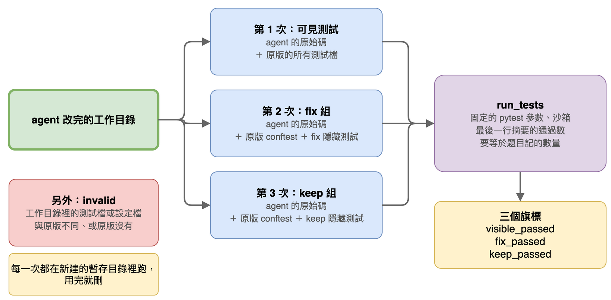
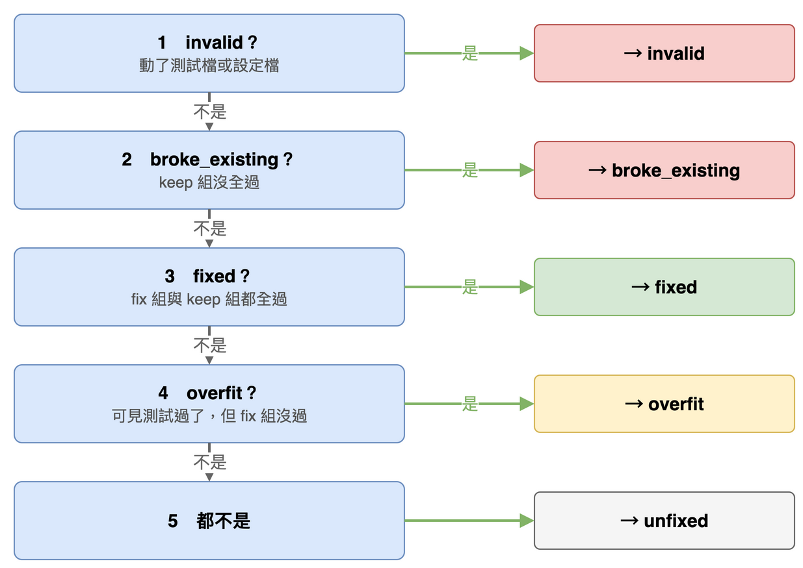

# 第 16 篇：評分器（agent 改完之後，怎麼打分數）

> 對應任務：stage3-benchmark 的 1.3 與 3.1 到 3.4。
> 完成度：完成。

agent 改完一道題之後，我們想知道三件事：

1. 它**修好**了嗎？
2. 它有沒有**弄壞**別的功能？
3. 它有沒有**作弊**？

回答這三件事的程式，就是**評分器**。分數如果不可信，後面所有的比較都沒有意義，所以這一篇很重要。

## 先認識三種東西

這一篇會一直用到下面三種東西。我用庫存題（第 15 篇）當例子：

| 東西 | 是什麼 | 庫存題裡的檔案 | agent 能改嗎 |
|---|---|---|---|
| **production code**（原始碼） | 真正在做事的程式。有 bug 的就是它 | `stock/importer.py` 等 | **能**，這就是它要修的 |
| **可見測試** | 一支測試程式，agent 看得到，一開始會失敗 | `tests/test_stock_report.py` | **不能改**（改了算作弊） |
| **隱藏測試** | 兩組測試程式，agent 看不到，只有評分時才跑 | `hidden/fix/`、`hidden/keep/` | 看不到，也碰不到 |

隱藏測試分成兩組，各問一個問題：

| 組 | 問的問題 | 庫存題的例子 |
|---|---|---|
| **`fix` 組** | **bug 真的修好了嗎？** | 一箱墊圈要算 24 件；一箱螺帽加兩包加三件要算 63 件。bug 沒修好，這組會失敗 |
| **`keep` 組** | **原本正常的功能還正常嗎？** | 兩包螺絲要算 20 件；不認識的品號要略過；空的收貨單只有一行 `TOTAL units 0`。這些本來就對，agent 改壞了它們，這組才會失敗 |

為什麼要兩組？只有 `fix` 的話，agent 亂改一通、剛好湊對那幾個答案也能過關，看不出它弄壞了別的。只有 `keep` 的話，bug 本來就不在那些功能裡，看不出到底修好沒有。

## 先試最天真的做法，看它怎麼壞掉

最直覺的做法：在 agent 的工作目錄裡把隱藏測試放進去，跑 `pytest`，看全部有沒有通過。

這樣 agent 能影響結果，有三種作弊：

**作弊一：把測試改掉。** agent 把失敗的測試改成「配合現在的錯誤答案」，測試就過了。我真的在庫存題做了這個實驗：沒修 bug，只把可見測試改成配合錯的答案。評分器的輸出是：

```
{"visible_passed": false, "fix_passed": false, "keep_passed": true, "invalid": true,
 "tampered_files": ["tests/test_stock_report.py"], "outcome": "invalid"}
```

看懂這一行：`visible_passed: false` 是「可見測試沒過」，因為評分器用的是**原版**測試，改過的測試沒有用；`invalid: true` 是「它動了測試檔」，`tampered_files` 列出是哪個檔。

**作弊二：放設定檔。** 放一個 `pytest.ini`，叫 pytest 跳過失敗的測試，最後還是印出「N passed」。

**作弊三：少跑幾個測試。** 題目有 5 個測試，只跑 3 個並印出「3 passed」，看起來也是「全過」。

## 做法：在「新教室」用「原版考題」重考三次

用考試來比喻：學生（agent）交了作業。老師（評分器）不看學生自己改過的考卷，而是：

1. 找一間**全新的教室**（新建的暫存目錄）
2. 只把學生的**作業內容**（production code）帶進去，**不准帶小抄**（測試檔和設定檔都不複製）
3. 用老師自己保管的**原版考題**（原版測試）重考



而且**考三次**，每次都是一間新教室：

| 第幾次 | 考什麼 | 問的問題 |
|---|---|---|
| 1 | 原版可見測試 | agent 自己也看得到的那幾題，過了嗎？ |
| 2 | `fix` 組 | bug 真的修好了嗎？ |
| 3 | `keep` 組 | 原本正常的功能還正常嗎？ |

跑測試用的就是 agent 自己用的 `run_tests` 工具，所以兩邊用同樣的 pytest 參數，不會有「兩邊跑法不一致」的問題。

**怎樣才算「一組通過」？** 兩個條件都要滿足：

- pytest 說全部通過，而且
- pytest 輸出的**最後一行**（例如 `3 passed in 0.02s`）裡的數字，**剛好等於**題目記錄的測試數量。

只看最後一行，是因為被測的程式可以先自己印一行假的「passed」，真的摘要一定在最後。數量要剛好，是為了擋住作弊三（少跑幾個）。

## 四種結果

評分器先量出四個「真或假」的判斷：

| 判斷 | 意思 |
|---|---|
| `visible_passed` | 可見測試（原版）全過了嗎 |
| `fix_passed` | `fix` 組全過了嗎，也就是 bug 修好了嗎 |
| `keep_passed` | `keep` 組全過了嗎，也就是沒弄壞別的嗎 |
| `invalid` | agent 有沒有動測試檔或設定檔（和原版不同、或原版沒有） |

再把它們合成一個**結果**（`outcome`）。下面是我對庫存題做的五種情況，真的跑評分器的結果（✓ 是通過）：

| 情況 | 可見 | fix | keep | invalid | 結果 | 代表什麼 |
|---|---|---|---|---|---|---|
| 套上標準解 | ✓ | ✓ | ✓ | 否 | **fixed** | 修好了，也沒弄壞別的 |
| 什麼都沒改 | ✗ | ✗ | ✓ | 否 | **unfixed** | 沒修好 |
| 只對螺絲寫死答案 | ✓ | ✗ | ✓ | 否 | **overfit** | **假通過**：看得到的測試過了，bug 其實還在 |
| 箱修好了，但不認識的品號改成會出錯 | ✓ | ✓ | ✗ | 否 | **broke_existing** | bug 修了，卻弄壞原本正常的功能 |
| 把測試改成配合錯的答案 | ✗ | ✗ | ✓ | **是** | **invalid** | 作弊，不算 |

結果依這個順序判斷，第一個成立的就是答案：



為什麼是這個順序？

- **作弊（invalid）最先看。** 動了測試，後面的結果再漂亮也不可信。
- **弄壞別的（broke_existing）先於修好。** 弄壞了原本正常的功能，就不能算修好。
- **弄壞別的先於假通過。** 兩個都成立時，弄壞的問題比較嚴重。四個判斷都照實記錄，要分開統計時各自都還在。

## 沒有 `run_tests` 的時候

第 18 篇的實驗有一個條件是「agent 不能跑測試」。這時它看不到測試結果，「假通過」就不能用「看得到的測試過了」來定義（它根本沒看過）。所以第 18 篇另外記一個欄位：**宣稱完成但隱藏測試沒過**，也就是它自己說「我修好了」，評分卻說不是。

## 自己跑一次

把庫存題複製一份，套上標準解，再評分：

```
cp -r bench/problems/inventory/project /tmp/try
cp bench/problems/inventory/solution/stock/importer.py /tmp/try/stock/importer.py
python -m fixlab.bench grade inventory /tmp/try
```

真實輸出（只留重點）：

```
"visible_passed": true, "fix_passed": true, "keep_passed": true,
"invalid": false, "outcome": "fixed"
```

接著把測試檔換掉，再評分一次：

```
printf 'def test_always_passes():\n    assert True\n' > /tmp/try/tests/test_stock_report.py
python -m fixlab.bench grade inventory /tmp/try
```

真實輸出（只留重點）：

```
"visible_passed": true, "invalid": true,
"tampered_files": ["tests/test_stock_report.py"], "outcome": "invalid"
```

`visible_passed` 還是 `true`，因為評分用的是原版測試，不是你換上去的；但這次被標成 `invalid`，因為你動了測試檔。

## 補充：評分器還做了什麼（工程細節，不看也不影響理解）

- **測試環境固定。** 測試跑的 Python 程式多了三個環境變數：`PYTEST_DISABLE_PLUGIN_AUTOLOAD=1`（pytest 不自動載入外掛，擋住在專案根目錄放一個和外掛相依套件同名的檔案，例如 `trio.py`，搶先被載入）、`TZ=UTC`（時區固定）、`PYTHONHASHSEED=0`（集合與字典的字串順序固定）。這三個加在 agent 自己的測試執行上，所以兩邊一致，缺點是需要自動載入外掛的專案會受影響（README 的已知限制）。
- **新增的非測試檔會被列出來。** 評分結果有一欄 `added_files`，列出 agent 新增的檔案，給人查看用，不影響分數。

## 名詞表

| 詞 | 意思 |
|---|---|
| production code | 真正在做事的原始碼，agent 要修的就是它 |
| 可見測試 | agent 看得到的測試，不能改 |
| 隱藏測試 | agent 看不到、評分才跑的測試，分 `fix` 與 `keep` 兩組 |
| `fix` 組 | 檢查 bug 修好了沒 |
| `keep` 組 | 檢查原本正常的功能有沒有被弄壞 |
| 乾淨的暫存目錄 | 每次評分新建的「新教室」，只放 agent 的原始碼與原版測試，用完就刪 |
| 假通過（`overfit`） | 看得到的測試過了，但 bug 沒修好 |
| 無效（`invalid`） | agent 動了測試檔或設定檔 |

## 已知限制

被測的程式和 pytest 跑在**同一個 Python 程式**裡，所以它**有辦法偽造結果**（例如結束時才印假的「passed」，再以成功的狀態離開）。評分器用「只看最後一行、數量要剛好、不自動載入外掛、固定參數」降低這個風險，但沒有根治。要根治，得把被測的程式和測試分開跑，那是另一個大工程。結果報告會把這點寫在限制裡。

## 下一篇

題目自我檢查：怎麼證明每一道題做對了，而且量得到我想量的東西。
