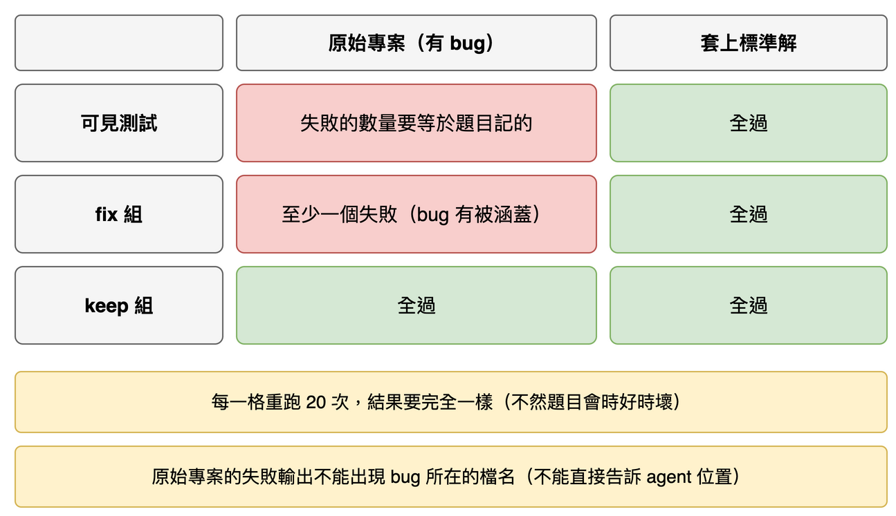

# 第 17 篇：題目自我檢查（怎麼證明題目量到想量的東西）

> 對應任務：stage3-benchmark 的 4.1 到 4.3。
> 完成度：完成。8 題全部通過，重跑 20 次。

題目寫好了。但怎麼知道它們沒問題？如果某一題的測試本來就會過、或者每次跑結果不一樣，那後面用它量出來的數字就沒有意義。有人問「你怎麼證明題目量到你想量的東西？」，這一篇就是答案。

## 先複習：每道題有哪些測試

每道題有三種測試（第 15、16 篇有詳細說明）：**可見測試**（agent 看得到，一開始會失敗）、**`fix` 組**（隱藏，檢查 bug 修好了沒）、**`keep` 組**（隱藏，檢查原本正常的功能有沒有被弄壞）。這一篇的檢查，就是確認這三種測試在「有 bug 的專案」和「套上標準解的專案」上，各自的表現都符合預期。

## 先試最天真的做法，看它怎麼壞掉

天真的做法：題目寫完，自己看一遍覺得沒問題，就拿去用。

這靠的是「我覺得」。下面是我故意弄壞庫存題的三種情形，用下面要介紹的自我檢查去跑，真實的輸出：

**情形一：`fix` 組的測試在原本有 bug 的專案上就已經通過**（也就是這組測試根本沒有涵蓋到 bug）：

```
inventory: FAILED
  - original fix: all fix tests pass, so the bug is not covered by the fix group
```

這樣的題目，agent 什麼都不改就能通過 `fix` 組，量不出它修沒修。

**情形二：`keep` 組裡有一個時好時壞的測試**（用時間決定要不要通過）：

```
inventory: FAILED
  - original keep: results differ between repetitions (flaky)
  - solved keep: results differ between repetitions (flaky)
```

這樣的題目，同一個結果跑兩次可能不同，分數就混進了運氣。

**情形三：可見測試的失敗輸出點名了 bug 所在的檔案**（例如丟了一個例外，錯誤訊息裡有 `importer.py`）：

```
inventory: FAILED
  - original visible: the failure output names importer.py, so the failure points at the bug location
```

這樣的題目，agent 一看輸出就知道去哪個檔案找，探索能力量不出來。

這三種問題，光看程式碼不容易發現。所以要用機器檢查。

## 做法：五項檢查，只用 pytest，不呼叫任何模型

`python -m fixlab.bench check` 對每一題做這些事。它只跑 pytest，不花任何 LLM 費用。



1. **列出的路徑都存在。** `problem.json` 裡寫的 bug 檔案和干擾檔，都要真的在 `project` 裡。
2. **原始專案（有 bug）：** 可見測試失敗的數量要等於題目記的數量；`fix` 組至少一個失敗（確認 bug 有被涵蓋）；`keep` 組全過；每一組實際跑的測試數量要和題目記的一致。
3. **套上標準解之後：** 三組全過。
4. **每一種執行重跑 20 次，結果要完全一樣。** 這是抓時好時壞的測試。
5. **原始專案的失敗輸出裡，不能出現 bug 所在的檔名。** 這是檢查「不透露位置」。

任何一題不符，就列出原因，並以非 0 的結束碼結束。

## 8 題的真實輸出

```
$ python -m fixlab.bench check
billing: passed
calendar: passed
inventory: passed
paging: passed
permissions: passed
scheduler: passed
settings: passed
subscription: passed
```

整個檢查在我的電腦上跑了約 2 分 10 秒（8 題，每題 6 種執行，每種重跑 20 次，共 960 次 pytest）。預設的題目集還會檢查題目剛好是固定的八個：多一題或少一題都會被報告。

## 一個它真的抓到的錯

寫第七題（排程）時，我把套件取名叫 `sched`。第一次跑檢查就失敗了：

```
scheduler: FAILED
  - original visible: 1 tests ran, problem.json says 2
  - original fix: 1 tests ran, problem.json says 3
  - original keep: 1 tests ran, problem.json says 3
  - solved visible: 1 tests ran, problem.json says 2
  ...
```

每一組都只跑了 1 個測試，而不是題目記的 2 或 3 個。原因是 Python 標準函式庫本來就有一個叫 `sched` 的模組，載入時它蓋過了我的套件，匯入就出錯了。我把套件改名為 `taskplan`，檢查就過了。這個錯誤如果沒被抓到，agent 面對的會是一道根本跑不起來的題目。

## 自己跑一次

只檢查一題、重跑 3 次（比較快）：

```
python -m fixlab.bench check inventory --repeat 3
```

要檢查所有題目、重跑 20 次（預設）：

```
python -m fixlab.bench check
```

想看它怎麼報告壞題目：複製一份題目，把 `hidden/fix/` 裡的測試改成只剩一個本來就會過的，用 `--problems-dir` 指到那個資料夾再跑一次。

## 名詞表

| 詞 | 意思 |
|---|---|
| 自我檢查 | 不用模型，只用 pytest 驗證題目本身做對了 |
| flaky | 同一個測試，同樣的程式，有時過有時不過 |
| 標準解 | 我寫的正確修法，檢查時套在原始專案上 |
| 涵蓋 | `fix` 組在有 bug 時會失敗，也就是這組測試真的檢查得到那個 bug |

## 已知限制

自我檢查證明題目「做對了」：邊界清楚、不會時好時壞、不洩漏位置。它不能證明題目「好」：夠不夠隱晦、規格有沒有寫清楚、是不是只有一種合理的修法，還是要靠人看。每一題我都人工讀過規格與隱藏測試，確認隱藏測試只測規格寫明的行為。

## 下一篇

實驗執行器：怎麼讓同一個 agent 在「有 `run_tests`」和「沒有 `run_tests`」兩種條件下，跑同樣的題目。
