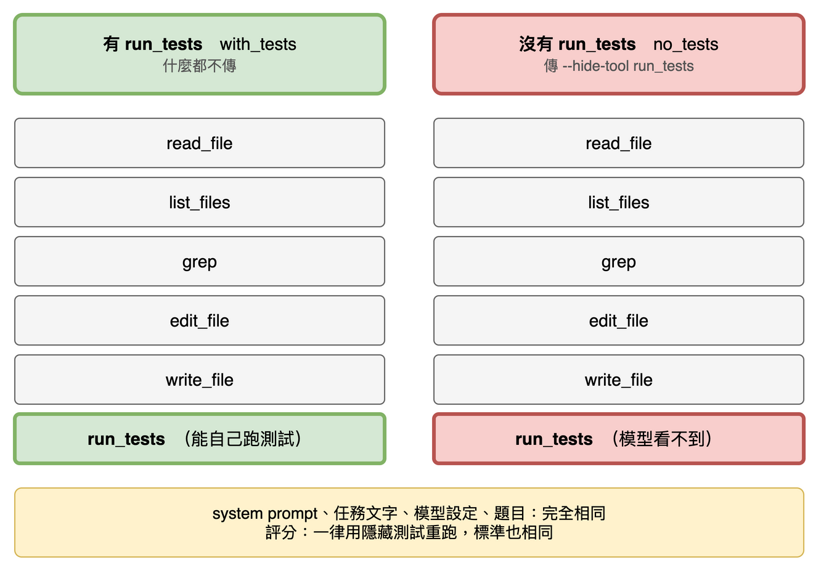
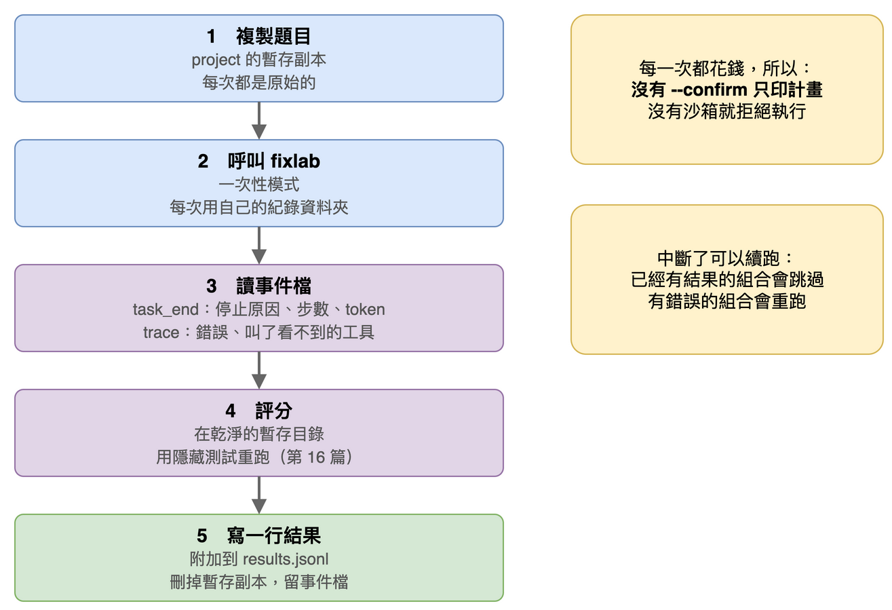

# 第 18 篇：實驗執行器（有 `run_tests` 對沒有 `run_tests`）

> 對應任務：stage3-benchmark 的 1.1、1.2、6.1 到 6.3 與 8.1。
> 完成度：完成。小規模實跑與完整的 160 次都跑過了（結果見第 19 篇）。

題目有了（第 15 篇），評分器有了（第 16 篇），題目也檢查過了（第 17 篇）。這一篇講怎麼讓同一個 agent，在「能自己跑測試」和「不能」兩種條件下，把所有題目跑一遍。

## 先試最天真的做法，看它怎麼壞掉

最直覺的做法：我自己一題一題、一個模型一個模型地執行 `fixlab`，看結果，記在筆記裡。

這會有四個問題：

1. **兩個條件不只差一個工具。** 要拿掉 `run_tests`，最容易想到的是改 system prompt（「你不能跑測試」）。但這樣兩邊的提示就不同了，差別就不只是工具。
2. **花錢沒有警告。** 一個指令按下去，160 次模型呼叫就開始了。
3. **中斷就全沒了。** 跑到第 100 次斷線，要從頭來。
4. **設定沒有記下來。** 幾天後想不起來這是哪個供應商、什麼設定跑的。

第四點我真的碰到了。先講背景：OpenRouter 是一個轉接站，你把請求送給它，它再轉給真正跑模型的伺服器。同一個模型可以有好幾家**供應商**（替模型跑伺服器的公司），速度與設定各不相同。括號裡的 `bf16`、`fp8` 是供應商把模型壓縮的方式（量化，名詞表有說明）。

下面是小規模實跑的真實紀錄：同一個模型（Qwen3.5-9B）、同一題、同樣的程式，只有供應商不同：

| 供應商 | 結果 | 耗時 |
|---|---|---|
| DeepInfra（bf16） | 修好 | **505 秒**（被限流 15 次：伺服器回「請求太多，等一下」，程式依規則等 5、15、30…秒再重試） |
| Venice（fp8） | 修好 | **27 秒**（沒有限流） |

如果沒有把供應商固定下來、也沒有記錄，這兩次的差別會被當成模型的差別。

## 做法一：兩個條件只差一個工具



`fixlab` 多了一個選項 `--hide-tool NAME`：被隱藏的工具不出現在給模型的工具清單裡，模型就不知道它存在。

- **有 `run_tests`（`with_tests`）：** 什麼都不傳，六個工具都在。
- **沒有 `run_tests`（`no_tests`）：** 傳 `--hide-tool run_tests`，模型只看得到另外五個。

system prompt、任務文字、模型設定、題目，兩個條件完全相同。模型就算亂叫 `run_tests`，也只會被當成「不認識的工具」，什麼都不會執行（執行器會把這種次數記成 `hidden_tool_calls`，這次 160 次裡是 0）。

隱藏只影響「模型看得到什麼」，不是把 `run_tests` 從程式裡拿掉。`fixlab` 結束時會自己跑一次測試，把結果顯示在畫面上，這是程式自己呼叫的，不受影響；正式的評分則另外由評分器做（第 16 篇）。

另外還加了兩個選項，用來固定實驗條件：

- `--temperature`：取樣的隨機程度。數字越高，模型每次的回答越不一樣；越低越穩定。
- `--extra-body`：一個 JSON，原樣放進每次請求，用來告訴 OpenRouter 只能用哪一家供應商。例如固定用 Venice：

```
--extra-body '{"provider": {"order": ["Venice"], "allow_fallbacks": false}}'
```

`allow_fallbacks: false` 的意思是「Venice 不能用時就報錯，不要自己換一家」，這樣才不會悄悄換了供應商。

隱藏的工具、`--temperature`、`--extra-body` 都會記進事件檔的 `run_start`。

## 做法二：先看計畫，確認了才會花錢

沒有加 `--confirm` 的話，`run` 指令只印出計畫，不會呼叫任何模型（真實輸出）。下面的 `5 repeats` 是每個組合重複跑 5 次：模型每次的回答都不一樣，只跑一次分不出是實力還是運氣：

```
$ python -m fixlab.bench run --models bench/models.json --out runs/stage3
160 runs: 8 problems x 2 models x 2 conditions x 5 repeats
models: qwen3.5-9b, claude-haiku-5.5
conditions: with_tests, no_tests
results file: runs/stage3/results.jsonl (0 done, 160 to run)
this is only the plan: every run calls a model and costs money; add --confirm to run it
```

加上 `--confirm` 才會真的跑。真的跑之前，它還會檢查兩件事，只要有一項沒通過，就以退出碼 2 結束，一次都不跑：

- 設定檔裡指到的金鑰環境變數有設嗎。
- **沙箱開著嗎。** 沒有沙箱的話，agent 的 `run_tests` 可以讀到放在專案目錄裡的隱藏測試，所以不能做正式實驗。

## 做法三：一次執行做五件事



1. 把題目的 `project` 複製到一個暫存目錄。每次都是原始的，上一次的修改不會留下來。
2. 用一次性模式（不進互動畫面，直接 `fixlab 路徑` 跑完一題就結束）呼叫 `fixlab`，每次有自己的紀錄資料夾。
3. 從那次的事件檔讀結果：`task_end` 有停止原因、步數、token、耗時；`trace`（事件檔裡記錄每次模型請求細節的事件）裡有請求失敗的錯誤，和模型叫了看不到的工具的次數。
4. 用評分器評分（第 16 篇）。
5. 寫一行結果到 `results.jsonl`，刪掉暫存副本，留下事件檔。

下面是小規模實跑寫出的一行（真實輸出，路徑與題目摘要略有縮短）：

```json
{
  "problem": "inventory",
  "model": "qwen3.5-9b",
  "condition": "with_tests",
  "repeat": 1,
  "grade": {"visible_passed": true, "fix_passed": true, "keep_passed": true, "invalid": false, "outcome": "fixed"},
  "stop_reason": "done",
  "steps": 10,
  "prompt_tokens": 19638,
  "completion_tokens": 1208,
  "seconds": 505.49,
  "claimed_done_but_failed": false,
  "hidden_tool_calls": 0,
  "log_path": "runs/stage3-smoke/logs/…/events.jsonl",
  "started_at": "2026-10-18T07:01:54+00:00",
  "error": null
}
```

`claimed_done_but_failed` 是「agent 自己宣告完成，但隱藏測試沒過」。沒有 `run_tests` 的條件下，agent 看不到測試結果，所以「假通過」要用這一欄來量。

## 做法四：續跑，和失敗不算進結果

每一行都寫完就立刻附加進檔案。中斷之後用同一個指令再跑一次：已經有結果的組合會跳過；最後一行有錯誤的組合會重跑。

「錯誤」和「沒修好」是不同的事。下面是我想把 Qwen 換成另一家供應商（Parasail）時，真的碰到的（真實輸出，只截一段）：

```
[2/2] inventory qwen3.5-9b no_tests #1: unfixed (error: NotFoundError("Error code: 404 - {'error': {'message': 'No endpoints found for qwen/qwen3.5-9b. Every candidate endpoint was removed during routing: Filter by Tool Compatibility removed parasail/bf16; ...
```

原因是那家供應商的 Qwen3.5-9B 不支援工具呼叫，而 `fixlab` 需要工具呼叫。兩次執行都在 0.3 秒內失敗，沒有花到錢。執行器把這種情況記成 `error`，不是 `unfixed`；報告會把有錯誤的執行另外用一欄計數，不算進修好率，不然「供應商出問題」會被誤判成「模型修不好」。

## 設定檔：模型與供應商都寫下來

模型寫在 `bench/models.json`：模型名稱、供應商、量化方式、temperature、單價（附來源與日期）、context 長度。金鑰**不放**在檔案裡，只寫「放金鑰的環境變數名稱」。每次執行期間，執行器暫時把端點與金鑰設給這個模型，執行完還原，所以每個模型走自己的端點，事件檔記到的端點也是對的。


## 自己跑一次

先只看計畫（不花錢）：

```
python -m fixlab.bench run --models bench/models.json --out runs/try
```

只跑一題、每個條件一次（兩個模型各兩次，約 $0.01，**會花錢**）：

```
source .env     # 內含 OpenRouter 的金鑰
python -m fixlab.bench run --models bench/models.json --out runs/try --problem inventory --repeats 1 --confirm
python -m fixlab.bench report runs/try/results.jsonl --models bench/models.json
```

## 名詞表

| 詞 | 意思 |
|---|---|
| 條件 | `with_tests`（有 `run_tests`）或 `no_tests`（沒有） |
| 隱藏工具 | 不給模型看的工具；程式自己仍然可以呼叫 |
| 供應商 | 替模型跑伺服器的公司（例如 Venice）。同一個模型換供應商，速度與量化可能不同 |
| 量化 | 把模型的數字壓小以省記憶體（例如 fp8）；壓得越小，精度可能越低 |
| 限流（429） | 伺服器說「請求太多，等一下」 |
| 續跑 | 中斷後再跑同一個指令，已經完成的不會重做 |

## 已知限制

- 兩個條件只差工具，但「沒有 `run_tests`」不等於「看不到測試」：agent 仍然能用 `read_file` 讀測試檔，只是不能執行。
- 一次只跑一個，沒有平行；160 次約 1 小時。
- 設定檔裡的價格與供應商資料是我當天查的（2026-10-18），之後可能變。

## 下一篇

第一次完整實驗的結果，以及怎麼讀這些數字。
