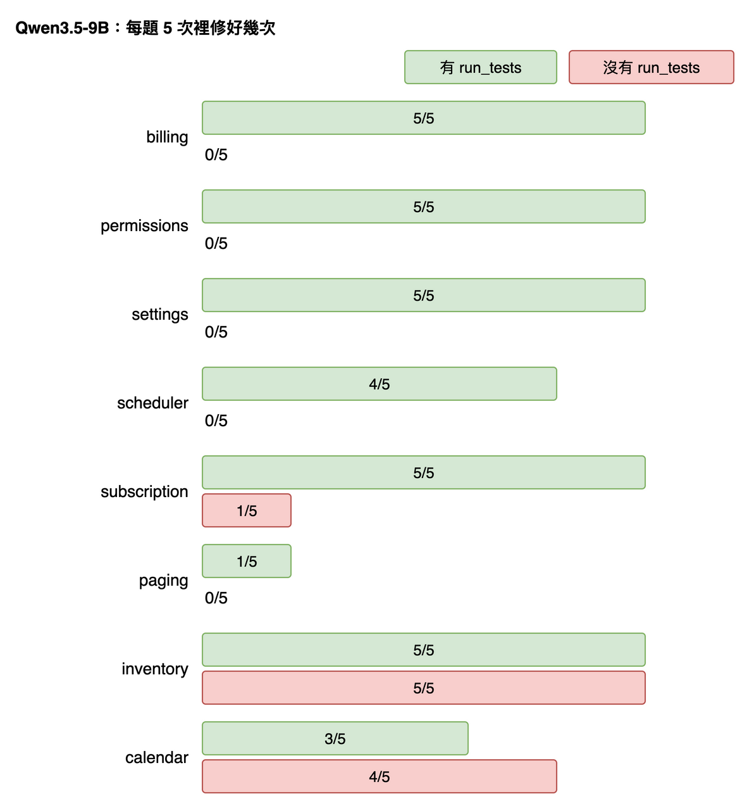
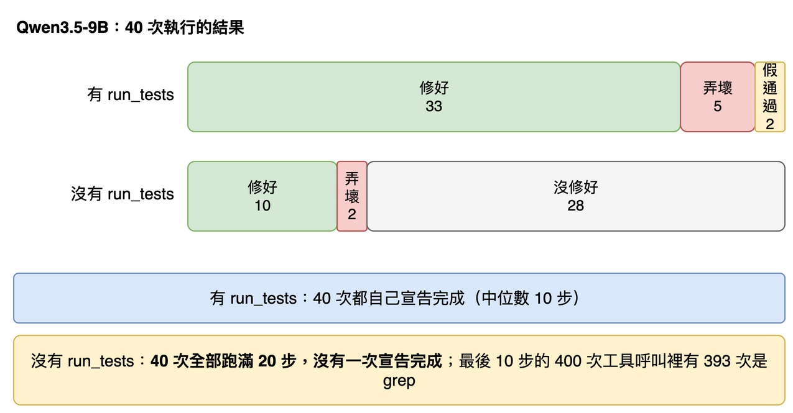

# 第 19 篇：第一次實驗結果，以及怎麼讀它

> 對應任務：stage3-benchmark 的 8.2、8.3。
> 完成度：完成。160 次全部跑完，0 次錯誤。完整的數字與限制在 `docs/benchmark-results.md`。

**這一篇所有結論都只是「在這組題目上觀察到」。** 8 道題、兩個模型，不能推論到別的題目或別的模型。

## 先試最天真的做法，看它怎麼壞掉

最直覺的讀法：看一個數字，**修好率**。

| 模型 | 有 `run_tests` | 沒有 `run_tests` |
|---|---|---|
| Claude Haiku 5.5 | 40／40（100%） | 40／40（100%） |
| Qwen3.5-9B | 33／40（82%） | 10／40（25%） |

這個表有用，但它會騙人：

**問題一：Haiku 兩邊都是 100%，是「測試沒用」嗎？** 不是。是這組題目對它太容易，**每一次都修好**，看不出差別。這叫天花板效果。要看它有沒有幫助，需要更難的題目。

**問題二：只跑一次，會得到相反的結論。** 看 Qwen 在 calendar 這題，同樣 5 次執行的真實結果：

| | 第 1 次 | 第 2 次 | 第 3 次 | 第 4 次 | 第 5 次 | 修好 |
|---|---|---|---|---|---|---|
| 有 `run_tests` | 修好 | 假通過 | 修好 | 修好 | 假通過 | 3／5 |
| 沒有 `run_tests` | 修好 | 修好 | 修好 | 修好 | 沒修好 | 4／5 |

如果只跑第 1 次，兩邊都修好，看不出差別；挑第 2 次，會得到「有測試反而比較差」。這就是為什麼每格要跑 5 次。

**問題三：「修好率」看不出它是怎麼失敗的。** 下面第二張圖說明了這一點。

## 結果一：有 `run_tests` 的差別，在每一題都不一樣



每一題 Qwen 跑 5 次。綠色是有 `run_tests`，紅色是沒有：

- **差別最大的三題：** billing、permissions、settings，有 `run_tests` 全部 5／5 修好，沒有的時候 **0／5**。
- **沒有差別：** inventory 兩邊都是 5／5。這題的症狀很直接（報表的件數明顯不對），不需要驗證。
- **有一題反過來：** calendar 沒有 `run_tests` 的反而多修好一次（4／5 對 3／5）。它有 `run_tests` 的兩次失敗都是「假通過」。
- **最難的是 paging：** 有測試 1／5，沒有 0／5。

把 8 題的差別平均：+0.57。意思是平均每一題，有 `run_tests` 比沒有多修好 0.57 的比例。

**95% 區間 [+0.22, +0.88] 是什麼意思？** 我們只有 8 題，換一組 8 題，平均差會不同。所以用電腦把這 8 題「隨機抽 8 次（可以重複）」重算平均差，這樣做 2000 次，取中間的 95%。區間整個在 0 的右邊，表示在這 8 題上，有測試比較好這件事不太像是運氣。但它只反映「題目之間的差異」，也只有 8 題。

## 結果二：沒有 `run_tests` 時，它不是亂宣稱，而是不敢結束



這是這次最有意思的發現。我本來預期：沒有測試驗證，agent 會常常「宣稱修好了，其實沒有」（假通過）。結果是：

- **有 `run_tests`：** 40 次都自己宣告完成（中位數 10 步），其中 33 次修好；7 次宣告完成卻沒修好（5 次弄壞既有功能、2 次可見測試過了但 bug 還在）。
- **沒有 `run_tests`：** **40 次全部跑滿 20 步，沒有一次宣告完成**，「宣稱完成但沒修好」這一格是 **0**。

為什麼？看事件檔：它最後 10 步的 400 次工具呼叫裡，**393 次是 `grep`**。沒有辦法驗證自己改對了沒有，它就一直搜尋，直到步數用完。

所以真正的失敗模式是「沒有驗證手段就無法結束」，不是「沒驗證卻宣稱完成」。

**要小心的地方：** 步數上限 20 是階段 1 訂的初始值，從來沒有用資料校準過。給它更多步數，它會不會最後宣告完成、宣告時又對不對，我們不知道。所以 25% 比較像「20 步內修好」的比例。

## 成本

| 模型 | 總成本 | 每次 | 每修好一題 |
|---|---|---|---|
| Qwen3.5-9B | $0.255 | $0.0032 | $0.0059 |
| Haiku 5.5 | $0.159 | $0.0020 | $0.0020 |

Qwen 的每百萬 token 單價比 Haiku 低（輸出 $0.15 對 $0.50），但**每修好一題反而貴約 3 倍**，因為它用了很多步數與 token，卻沒有那麼常修好。整個實驗花約 $0.41、約 59 分鐘。單價取自 OpenRouter 的公開 API（2026-10-18）。

## 這組結果不能說什麼

- **不能說 Qwen 比 Haiku 差。** 兩個模型的設定不同（Haiku 的 temperature 無法設定），而且 Haiku 碰到天花板。
- **不能說測試對所有 agent 都有用。** Haiku 完全看不出差別。
- **不能說 25% 是 Qwen 沒有測試時的修好率。** 步數上限沒校準。
- **數字的可重現程度有限。** 沒有固定 seed，供應商也在變。
- 被測的程式能偽造結果的風險仍在，只是降低了（第 16 篇）。

## 自己跑一次、自己看

原始紀錄不進版控。要重現數字：

```
source .env
python -m fixlab.bench run --models bench/models.json --out runs/stage3 --confirm
python -m fixlab.bench report runs/stage3/results.jsonl --models bench/models.json
```

約 $0.4、約 1 小時，結果不會完全一樣（沒有固定 seed），但分布應該接近。完整的報告輸出、所有調整記錄與限制都在 `docs/benchmark-results.md`。

## 名詞表

| 詞 | 意思 |
|---|---|
| 修好率 | 修好的次數除以總次數 |
| 假通過 | 可見測試過了，但 bug 沒修好 |
| 天花板效果 | 題目太容易，每次都滿分，分不出差別 |
| 成對比較 | 同一題，兩個條件各算一個比例，再相減；最後 8 題的差取平均 |
| 95% 區間 | 對題目重抽樣算出來的範圍；中間 95% 的平均差落在這裡 |
| 步數用完 | agent 沒有宣告完成，直到步數上限（20）才被迫停下 |

## 下一步可以做什麼（還沒做）

- 更難的題目，讓 Haiku 也有分別。
- 用資料校準步數上限，看 Qwen 沒有測試時給更多步數會怎樣。
- 消融：system prompt 的規則、工具輸出的截斷。
